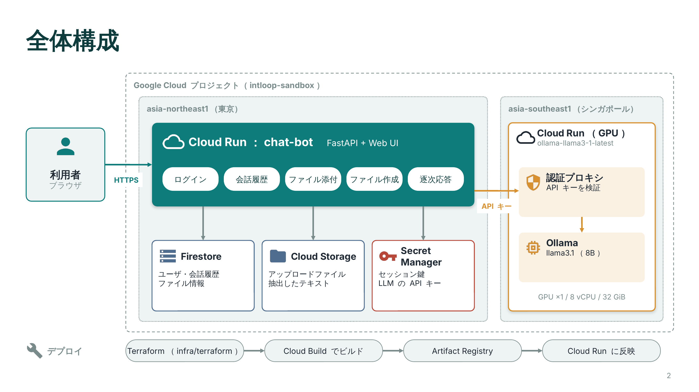

# chat-bot-localllm

Cloud Run 上にデプロイしたローカル LLM（Ollama / vLLM などの OpenAI 互換サーバ）を参照するチャットボットです。
**ユーザごとに会話履歴を保存**し、過去の会話を再開・検索・複製（分岐）して再利用できます。

```
ブラウザ ──> chat-bot (Cloud Run, FastAPI + Web UI) ──(ID トークン)──> Local LLM (Cloud Run: Ollama 等)
                       │
                       ├── 会話履歴・ファイル情報 (Firestore)
                       └── アップロードファイル (Cloud Storage)
```



システム構成の資料（PowerPoint）: [docs/architecture.pptx](docs/architecture.pptx)

## 機能

| 機能 | 内容 |
| --- | --- |
| ユーザ管理 | ユーザ名/パスワードでのログイン（`AUTH_MODE=local`）、または IAP の Google アカウント（`AUTH_MODE=iap`） |
| 会話履歴 | ユーザごとに Firestore へ保存。サイドバーに「今日 / 昨日 / 過去7日間…」でグループ表示 |
| 再利用 | 過去の会話を開いてそのまま続きから会話（履歴は LLM に文脈として送信） |
| 検索 | タイトル・本文の全文検索 |
| 複製・分岐 | 会話全体の複製、任意のアシスタント応答の時点から新しい会話として分岐 |
| 編集・再生成 | 送信済みメッセージを編集して再送、最後の応答を再生成 |
| ピン留め・名前変更・削除 | よく使う会話を上部に固定 |
| 会話ごとの設定 | モデル選択・システムプロンプト |
| エクスポート | Markdown / JSON |
| ファイル添付 | 📎・ドラッグ＆ドロップ・貼り付けで PDF / Word / Excel / PowerPoint / テキスト・ソースコードを添付し、その内容を踏まえて回答（詳細は下記） |
| ファイル作成 | 回答を Word / Excel / PowerPoint / HTML / Markdown / テキストとして保存。コードブロック（CSV・JSON・プログラム等）は個別にダウンロード（詳細は下記） |
| ストリーミング | 応答を逐次表示、途中停止可（停止までの内容も保存） |

## ファイル添付の仕組み

1. アップロード時にテキストを抽出し、元ファイルと抽出テキストを Cloud Storage に、ファイル名などの情報を Firestore に保存します。
   - 対応形式: PDF（テキストを含むもの）、Word（.docx）、Excel（.xlsx/.xlsm、シートごとに CSV 化）、PowerPoint（.pptx、ノート含む）、
     テキスト・Markdown・CSV・JSON・ソースコードなど（UTF-8 / Shift_JIS / EUC-JP を自動判別）
   - 未対応: 画像、スキャンした画像だけの PDF（llama3.1 は画像を読めないため）、旧形式の .doc/.xls/.ppt
2. ファイルは**会話単位**で保持され、その会話の以降のすべての回答で参照されます（📎 ボタンの一覧から削除すると参照されなくなります）。
3. 回答時、ファイル本文の合計が `FILE_CONTEXT_CHARS`（既定 8,000 文字）以内なら全文を、超える場合は
   直近の質問に関連する部分（約 1,200 文字のチャンク）だけを検索して LLM に渡します。
   検索は BM25（日本語は文字 2-gram）で、追加の埋め込みモデルは不要です。
4. Ollama の既定のコンテキスト長は小さく長い入力が切り捨てられるため、`LLM_NUM_CTX`（既定 16,384）を指定しています。

大きな資料で精度が足りない場合は、`FILE_CONTEXT_CHARS` と `LLM_NUM_CTX` を一緒に増やしてください
（日本語はおおむね 1 文字 1〜1.5 トークン。GPU メモリの使用量も増えます）。

## ファイル作成の仕組み

LLM には普段どおり Markdown（見出し・箇条書き・表・コードブロック）で回答させ、サーバ側で各形式に変換します。
内容の種類（議事録・集計表・資料など）は固定しません。

| 形式 | 変換内容 |
| --- | --- |
| Word | 見出し・段落・太字・箇条書き（入れ子・番号付き）・表・コードをそれぞれの書式に変換 |
| Excel | 回答中の表（Markdown の表、CSV/TSV のコードブロック）を 1 表 = 1 シートに。数値・% は数値として入力。表がなければ本文を A 列に |
| PowerPoint | 見出しごとに 1 スライド（最上位の見出しが 1 つなら表紙）。箇条書きは本文、表は表スライド。長い場合は自動で分割 |
| HTML | そのまま閲覧・印刷用（ブラウザの印刷から PDF 保存も可） |
| Markdown / テキスト | 回答をそのまま保存 |

- 各回答の「ファイルに保存 ▾」から形式を選んでダウンロードします。質問文に「Excel」「スライド」などが含まれる場合は、その形式の保存ボタンを回答の下に表示します。
- コードブロックには右上に「⬇ ファイル名」ボタンが付きます。LLM が ` ```csv:売上.csv ` のように書いた場合はその名前で保存します（CSV は Excel で文字化けしないよう BOM 付き）。
- LLM には「回答はファイルとして保存できるので、ファイル作成を頼まれたら中身を出力すること」をシステムプロンプトで伝えています。
- 色・フォント・グラフ・数式などの細かい装飾は対象外です。

## ローカルで動かす

```bash
pip install -r requirements.txt
cp .env.example .env   # LLM_BASE_URL / FIRESTORE_PROJECT などを編集
```

Firestore には Application Default Credentials で接続します（`gcloud auth application-default login`）。
実プロジェクトを使わずに試す場合は Firestore エミュレータを起動し、`FIRESTORE_EMULATOR_HOST` を設定してください:

```bash
gcloud emulators firestore start --host-port=localhost:8085
```

```bash
set -a && source .env && set +a && uvicorn app.main:app --reload --port 8080
```

http://localhost:8080 を開き、「アカウントを作成する」からユーザを作成してください。

ローカルから IAM 認証付きの Cloud Run の LLM を呼ぶ場合は、`LLM_USE_ID_TOKEN=true` のうえ
サービスアカウントの認証情報が必要です（ユーザ認証情報では ID トークンを発行できないため）。
手軽に試すには Cloud Run プロキシを使い、`LLM_BASE_URL=http://localhost:11434`、`LLM_USE_ID_TOKEN=false` にします:

```bash
gcloud run services proxy ollama --region asia-northeast1 --port 11434
```

## 環境変数

| 変数 | 既定値 | 説明 |
| --- | --- | --- |
| `LLM_BASE_URL` | `http://localhost:11434` | Local LLM の Cloud Run URL |
| `LLM_API_TYPE` | `ollama` | `ollama`（`/api/chat`）または `openai`（`/v1/chat/completions`） |
| `LLM_MODEL` | `gemma3:4b` | 既定モデル。UI ではサーバの一覧から選択可能 |
| `LLM_USE_ID_TOKEN` | `false` | IAM 認証付き Cloud Run を呼ぶ際に ID トークンを `X-Serverless-Authorization` ヘッダで付与 |
| `LLM_API_KEY` | - | LLM サーバ（または前段のプロキシ）が要求する API キー。ID トークンと併用可 |
| `LLM_API_KEY_HEADER` | `Authorization` | API キーを送るヘッダ。`Authorization` は `Bearer` 形式、それ以外（`X-API-Key` 等）はキーをそのまま送信 |
| `LLM_TIMEOUT` | `300` | LLM 応答のタイムアウト秒 |
| `SYSTEM_PROMPT` | 日本語アシスタント | 既定のシステムプロンプト |
| `LLM_NUM_CTX` | `16384` | Ollama のコンテキスト長（`0` で Ollama の既定値） |
| `MAX_HISTORY_MESSAGES` | `40` | LLM に送る直近の履歴件数 |
| `FIRESTORE_PROJECT` | 実行環境の既定 | 履歴を保存する Firestore のプロジェクト |
| `FIRESTORE_DATABASE` | `(default)` | Firestore のデータベース ID |
| `FILES_BUCKET` | - | アップロードファイルの保存先バケット。未指定時はローカルディスク（`FILES_LOCAL_DIR`、既定 `./data/uploads`） |
| `MAX_UPLOAD_MB` | `20` | 1 ファイルの最大サイズ（Cloud Run の上限 32MB 未満） |
| `MAX_FILES_PER_CONVERSATION` | `20` | 1 会話に添付できるファイル数 |
| `FILE_CONTEXT_CHARS` | `8000` | 1 回の回答で LLM に渡すファイル本文の上限文字数 |
| `FILE_CHUNK_CHARS` | `1200` | 検索用チャンクの文字数 |
| `AUTH_MODE` | `local` | `local` / `iap` |
| `ALLOW_SIGNUP` | `true` | 画面からの新規登録を許可 |
| `SESSION_SECRET` | ランダム | セッション Cookie 署名鍵。**本番では必ず固定値を設定** |
| `COOKIE_SECURE` | `false` | HTTPS 環境では `true` |

## Cloud Run へのデプロイ

### 1. 履歴の保存先（Firestore）

会話履歴は Firestore（ネイティブモード）に保存します。データ構造は以下の通りで、
会話はユーザのサブコレクションに置くため、他ユーザの会話には構造的にアクセスできません。

```
users/{user_id}                                      username, password_hash, created_at
  conversations/{conv_id}                            title, model, system_prompt, pinned,
                                                     search_text, created_at, updated_at
    messages/{msg_id}                                seq, role, content, attachments, created_at
    files/{file_id}                                  name, content_type, size, chars,
                                                     original_key, text_key, created_at
```

ファイル本体は Cloud Storage の `users/{user_id}/conversations/{conv_id}/files/{file_id}/`（`original` と `text.txt`）に保存します。
会話を削除するとファイルも削除されます。

- 追加のインデックス作成は不要です（単一フィールドの自動インデックスのみ使用）。
- Firestore は部分一致検索ができないため、会話ドキュメントに本文を小文字化した `search_text` を保持し、
  アプリ側で絞り込んでいます（1 会話あたり 20 万文字まで）。
- データベースの作成とサービスアカウントへの `roles/datastore.user` 付与は Terraform が行います。

### 2. Terraform でインフラ構築・デプロイ

インフラは `infra/terraform` で管理します。

| リソース | 内容 |
| --- | --- |
| `google_project_service` | Cloud Run / Firestore / Secret Manager / Artifact Registry / Cloud Build / IAM の API 有効化 |
| `google_artifact_registry_repository` | コンテナイメージの保存先（直近 10 バージョンを保持） |
| `google_service_account` | チャットボット専用サービスアカウント |
| `google_firestore_database` | 会話履歴用 Firestore（ネイティブモード、削除保護あり） |
| `google_storage_bucket` | アップロードファイルの保存先（公開アクセス禁止。`files_retention_days` で自動削除も可） |
| `google_secret_manager_secret` | セッション Cookie 署名鍵（`random_password` で生成） |
| IAM | Firestore 読み書き（`roles/datastore.user`）、バケットの読み書き（`roles/storage.objectAdmin`）、署名鍵の参照、**既存 LLM サービスの `roles/run.invoker`** |
| `google_cloud_run_v2_service` | チャットボット本体（タイムアウト 3600 秒、`/healthz` のプローブ） |
| 公開設定 | `allow_unauthenticated=true` で allUsers に公開（アプリ側でログイン）、`false` で `invoker_members` のみ |

既存の Local LLM の Cloud Run サービスはデータソースとして参照するだけで、Terraform の管理下には入りません。
LLM 側は `--no-allow-unauthenticated` のまま非公開にでき、チャットボットは ID トークンで呼び出します。

#### 前提

- Terraform 1.5 以上、gcloud CLI（`gcloud auth login` と `gcloud auth application-default login` 済み）
- 実行ユーザに Owner、または同等の権限（API 有効化、IAM 付与、Cloud Run / Firestore / Secret Manager / Artifact Registry の管理）

#### 手順

```bash
cp infra/terraform/terraform.tfvars.example infra/terraform/terraform.tfvars   # project_id などを編集
```

```bash
infra/scripts/deploy.sh
```

`deploy.sh` は次の順で実行します（イメージの push 先を先に作る必要があるため 2 段階で apply します）:

1. `terraform apply -target` で API 有効化と Artifact Registry を作成
2. `infra/scripts/build.sh` で Cloud Build によりイメージをビルド・push
3. `terraform apply -var image=...` で全リソースを作成・更新し、URL を出力

アプリだけを更新する場合も同じスクリプトを再実行してください（新しいタグのイメージで Cloud Run が更新されます）。

#### 補足

- **Firestore の `(default)` データベースが既に存在する場合**は `create_firestore_database = false` にするか、import してください:
  ```bash
  terraform -chdir=infra/terraform import 'google_firestore_database.chat[0]' 'projects/PROJECT_ID/databases/(default)'
  ```
- **初回 apply で `API has not been used in project ... or it is disabled` (403) が出る場合**:
  API 有効化の反映待ちです。`api_propagation_wait`（既定 90 秒）で待機していますが、足りない場合は
  数分待って再実行するか、`api_propagation_wait = "180s"` のように延ばしてください。
- **state の管理**: セッション署名鍵が state に含まれます。チームで運用する場合は `backend.tf.example` を参考に
  GCS バックエンド（バージョニング有効）を使ってください。
- **削除**: `deletion_protection = true`（既定）の間は Cloud Run と Firestore を `terraform destroy` で削除できません。
  削除する場合は `false` にして apply してから destroy してください。

### 社内向けに Google アカウントで制限したい場合

Cloud Run に IAP を有効化し、`AUTH_MODE=iap` を設定すると、IAP が付与する
`X-Goog-Authenticated-User-Email` ヘッダでユーザを識別し、パスワード管理が不要になります。
（IAP を経由しないアクセスを防ぐため、Ingress を内部 + ロードバランサ、または IAP 必須にしてください。）

## API

| メソッド | パス | 説明 |
| --- | --- | --- |
| POST | `/api/auth/signup` `/api/auth/login` `/api/auth/logout` | 認証 |
| GET | `/api/conversations?q=` | 自分の会話一覧（検索） |
| POST | `/api/conversations` | 会話作成 |
| GET / PATCH / DELETE | `/api/conversations/{id}` | 取得 / 更新（タイトル・ピン・モデル・システムプロンプト） / 削除 |
| POST | `/api/conversations/{id}/messages` | メッセージ送信（SSE ストリーム応答）。`edit_message_id` で編集再送 |
| POST | `/api/conversations/{id}/regenerate` | 最後の応答を再生成（SSE） |
| POST | `/api/conversations/{id}/duplicate` | 複製・分岐（`upto_message_id`） |
| GET | `/api/conversations/{id}/export?format=md\|json` | エクスポート |
| POST | `/api/conversations/{id}/files` | ファイルアップロード（multipart、`files` に複数可） |
| GET | `/api/conversations/{id}/files` | 添付ファイル一覧 |
| GET / DELETE | `/api/conversations/{id}/files/{file_id}` | ダウンロード / 削除 |
| GET | `/api/conversations/{id}/messages/{message_id}/export?format=docx\|xlsx\|pptx\|html\|md\|txt` | 回答をファイルに変換してダウンロード |
| GET | `/api/models` | LLM サーバのモデル一覧 |

## テスト

```bash
pip install -r requirements-dev.txt && pytest -q
```
